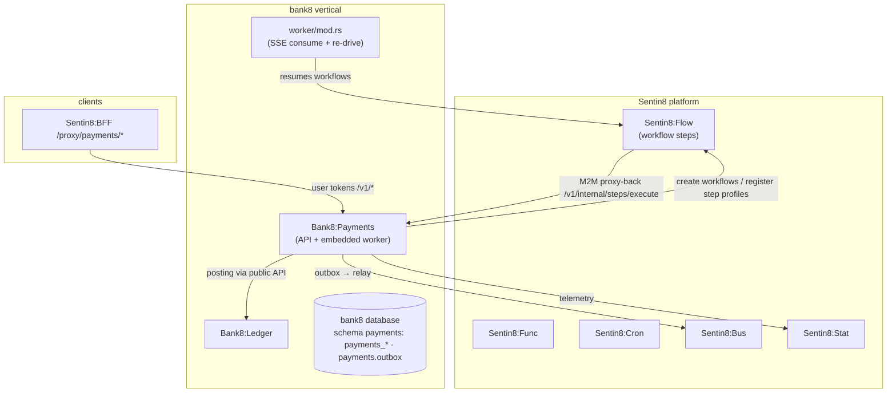

# Bank8:Payments — README

Payment orchestration: instructions, scheme flows (B8/SEPA/TIPS/SWIFT,
ISO 20022), cards (issuing + lifecycle + 3-D Secure), mandates, rule
engine, files, and the manual-decision task loop — delegating step
execution to Sentin8:Flow and money movement to Bank8:Ledger.

## Summary

Bank8:Payments is a Rust service owning the payments schema in the bank8
vertical database. It turns payment instructions into Flow workflows,
executes scheme-specific flows (ISO 20022 message families), manages
card lifecycle and mandates, and keeps the rule/parameter configuration
library that drives routing and eligibility. It never posts balances
itself — every money movement calls Bank8:Ledger's API.

## Motivation

Payment execution is inherently multi-step (validation → routing →
scheme call → settlement → posting), spans minutes for some schemes, and
requires human decisions (manual approvals, risk reviews). The service
centralizes that orchestration behind one policy-gated API while the
platform provides the execution primitives: Flow runs the step engine,
Cron schedules, Func runs tenant hooks, and the ledger owns the money.

## Architecture & High-Level Design

## Key Traits and Data Structures

- `AppState` — config, capped pool, Shield engine (shell-booted), the
  shared admin surface; handlers gate via `policy::require`.
- `event_streaming` — the DBX producer path: `emit_event_tx`
  (in-transaction) and `emit_event` (pool helper), with
  `PublisherIdentity` carrying the caller's token/subject onto the
  outbox row.
- `state_machine` — the instruction lifecycle: legal transitions only,
  auto-synced payment status per transition.
- `b8_flows` / `sepa_flows` / `tips_flows` / `swift_agi` — per-scheme
  flow implementations over the typed ISO 20022 payload catalogue
  (`bank8-payments-contracts`).
- `cards` — card issuing/lifecycle with a deterministic placeholder
  crypto layer, 3-D Secure records, and scheme simulator adapters
  (`visa_dps`, `mdes`).

## Rationale, Trade-offs, and Alternatives

- **Flow owns execution, Payments owns domain steps** — the workflow
  engine, retries, and wait states are the platform's; this service
  implements the step functions behind `POST /v1/internal/steps/execute`
  (proxy-back). No embedded saga engine.
- **Money movement only via the Ledger API** — payments never
  shadow-write ledger balances; the posting is a step that calls the
  ledger's public API like any client.
- **Typed ISO 20022 catalogue** — the shared contracts enum keeps
  message-code handling compile-total instead of stringly-typed.
- **Sandbox simulator adapters ship with the service** — scheme
  gateways (Visa DPS, MDES, SWIFT) are integration-config-driven; the
  simulators exercise the same code paths in dev without external
  dependencies.

## Internal Implementation & Invariants

- Instruction state transitions are machine-guarded; terminal states
  are immutable (same predicate the worker uses).
- Events ride `payments.outbox` in the domain transaction — a crash
  between commit and produce loses nothing.
- Rules/parameters/logics are versioned entities with publish flows;
  drafts never execute.
- All tenant tables FORCE-RLS on `env_id`; cardholder data is
  holder-scoped.

## Unresolved Questions / Future Designs

- Scheme certification is tenant-driven by design (DESIGN.md §10); the
  vertical ships the runbook, not the certification.
- File debatch is **implemented** as a per-file Flow workflow
  (`file-debatch`) with the `/v1/internal/files/debatch` proxy-back
  (DESIGN.md §10).
- Recurring schedules are **wired** to Sentin8:Cron
  (`register_recurring_schedule` → Cron API + boot seed of the default
  schedules); `v1beta/scheduled-payments` stays beta until the recurring
  e2e spec lands.

---

**Design attribution:** bank8:payments and its underlying concepts were designed by Hamid Jahanzad <Hamid@Jahanzad.com>.
